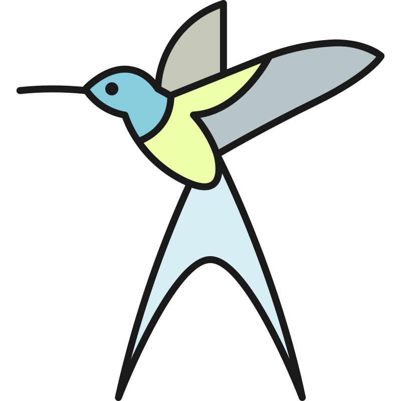

<div align="center">
  <picture>
    
  </picture>
<br>

<h2>Tinybird</h2>

[](https://github.com/habedi/tinybird/actions/workflows/tests.yml)
[](examples)
[](docs)
[](https://ziglang.org/download/)
[](https://microzig.tech/)
[](LICENSE)

A tiny application platform for microcontrollers

</div>

---

Tinybird is a tiny Wasm-based application platform for microcontrollers.
The main goal of the project is to provide a consistent execution environment and hardware API that allows developers to write applications once
and run them on different devices without modifying their code.

See [ROADMAP.md](ROADMAP.md) for the list of implemented and planned features.

> [!IMPORTANT]
> Tinybird is in early development, so bugs and breaking changes are expected.
> Use the [issues page](https://github.com/habedi/tinybird/issues) to report bugs or request features.

---

### Quickstart

> [!IMPORTANT]
> The instructions below are for Linux and macOS.
> It's recommended to use Windows Subsystem for Linux (WSL) on Windows.
> Additionally, you need Nix installed.
> Currently, only the Raspberry Pi Pico 2 board is supported.

<div align="center">
  
</div>

Clone the repository with submodules:

```shell
git clone --recurse-submodules https://github.com/habedi/tinybird.git
cd tinybird
```

Enter the development environment and build:

```shell
# Enter the Nix dev shell and install the Python tools
make shell
make install

# Run the host-side tests (no board needed)
make test

# Build the CLI runner, sample Wasm apps, and firmware
make build
```

Run a sample WebAssembly application on the host:

```shell
# Run the hello world example
./zig-out/bin/tinybird run zig-out/examples/hello.wasm

# Run the add example with arguments
./zig-out/bin/tinybird run zig-out/examples/add.wasm add 10 20
```

Flash the firmware to a connected Raspberry Pi Pico 2:

```shell
# Flash the MCU over USB
make flash
```

```shell
# See all available commands and their descriptions
make help
```

---

### Contributing

See [CONTRIBUTING.md](CONTRIBUTING.md) for details on how to make a contribution.

### License

Tinybird is licensed under the Apache License, Version 2.0 (see [LICENSE](LICENSE)).

### Acknowledgements

- The logo is from [SVG Repo](https://www.svgrepo.com/svg/417382/bird) with some modifications.
